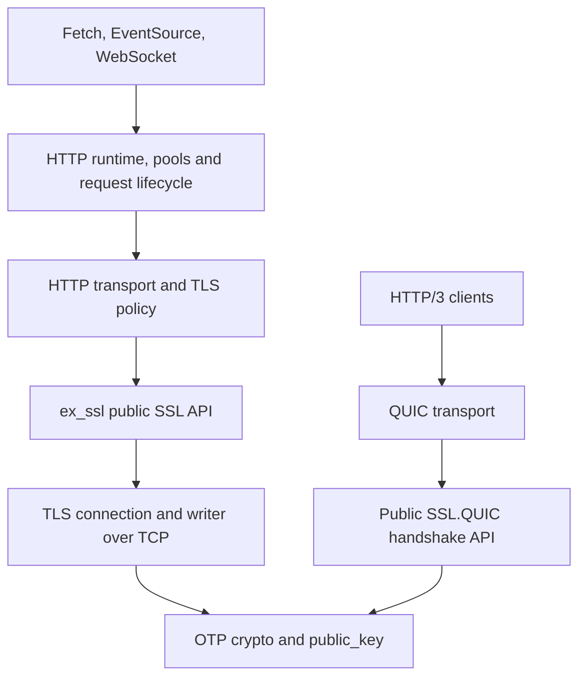

# HTTP Fetch: Complete the ex_ssl Migration and Remove Production OTP SSL

## 1. Goal and review baseline

Make `ex_ssl` the sole production TLS implementation used by the HTTP Fetch umbrella. Preserve the supported HTTP client contracts, including cancellation, streaming, pooling, managed transports, and cleanup completion. After migration, the published production dependency graph and a minimal release must operate without the OTP `:ssl` application or its modules.

Performance optimization, comparative latency, throughput, and resource measurements and budgets, and dedicated benchmarks and measurement soaks are TODO outside the current migration goal. This scope decision overrides performance completion requirements elsewhere in this plan; previously failing measurements retain their failure status. Functional timeout and cancellation behavior, lifecycle and resource release, long-lived shutdown, security (including no fallback or replay), compatibility, source and candidate-package acceptance, supported-platform validation, CI, and release gates remain required.

**Repository:** https://github.com/gsmlg-dev/http_fetch  
**Reviewed branch and commit:** `main` at `6b69bde3f43f2270317c38fbe68d5ac9635d3b36`  
**Reviewed version:** `0.21.14`  
**Review date:** 2026-10-21, Asia/Shanghai  
**Document status:** Proposed implementation plan, ready for a coding agent to execute in stages.

This plan is based on inspection of the current source, tests, manifests, and CI/release tooling. The Elixir suites were not executed during preparation. Existing test files establish authored coverage; historical validation reports retain their original version boundaries. Revalidate against the execution checkout before changing code.

The canonical TLS implementation is **`apps/ex_ssl` in this repository**. The separate `gsmlg-dev/ex_ssl` repository and its v0.7.2 release are historical provenance, not the implementation baseline for this work. The umbrella already contains nine coordinated packages. [S1]

## 2. Current state and confirmed migration blockers

The TLS engine and ordinary client integration already exist. Preserve and extend them rather than rebuilding the stack.

| Area | Observed current state | Migration implication |
| --- | --- | --- |
| Independent TLS engine | `apps/ex_ssl` implements TLS using `:crypto` and `:public_key`; its production library source contains no OTP `:ssl` calls. | Complete the consumer contract and integration. |
| TLS features | TLS 1.3, a bounded TLS 1.2 implementation, ALPN, peer verification, DNS/IP reference identity, initial mTLS, ownership transfer, active-once, streaming writes, and optional TLS 1.3 resumption exist. | Reuse their tests and close specific compatibility gaps. |
| Default backend | `HTTP.TLSBackend.resolve/1` defaults to `:ssl`. | Change only after migration gates pass. |
| Effective TLS versions | OTP adapter defaults to TLS 1.3 + TLS 1.2; ExSSL adapter defaults to TLS 1.3 only. | A selector-only change would lose TLS 1.2 connectivity. |
| Request completion | `HTTP.RequestCompletion.new/2` explicitly rejects `:ex_ssl`. | Existing public cleanup completion would regress after a default change. |
| Managed transport | `HTTP.ManagedTransport.Policy.freeze/1` accepts and freezes only `:ssl`. | Managed H1/H2 cannot currently migrate. |
| Lifecycle accounting | `HTTP.RequestLifecycle` extracts TCP/receiver/sender resources from two private OTP socket layouts. | Add a public provider lifecycle contract before enabling ExSSL completion. |
| Managed socket defaults | Policy injects `buffer: 65_536`; the ExSSL adapter and engine reject raw `:buffer`. | Removing the backend guard alone still breaks connection setup. |
| Setup failures | ExSSL adapter does not provide the equivalent lifecycle and setup-phase evidence used by the OTP path. | Preserve truthful cleanup and structured retry/error semantics. |
| Duplex control output | During an occupied application writer, required inbound TLS control responses can fail closed with `:busy`. | Resolve this operational limitation before promising general default parity. |
| Production applications | Five HTTP packages unconditionally declare `:ssl` in `extra_applications`. | Remove those declarations and prove the transitive production closure is clean. |
| Existing CI | Candidate package tests, independent TLS peers, H2 compatibility, and HTTP/3 checks already exist. | Extend and require them on relevant changes; do not build a parallel test system. |

Primary source locations: [S2]–[S10]. These are migration constraints, not claims that an already-disabled ExSSL completion path currently crashes production.

## 3. Target architecture and boundaries

### Ownership

- `apps/ex_ssl` owns TLS protocol state, PKIX policy, record protection, writer ordering, provider resource cleanup, and public lifecycle evidence.
- `apps/http_core` owns the HTTP transport boundary, effective TLS configuration, and request-level lifecycle integration.
- `apps/http_runtime` owns dialing, H1/H2 pools, managed scopes, capacity accounting, and transfer of connection ownership.
- Fetch, EventSource, and WebSocket retain their existing API and protocol responsibilities.
- QUIC retains its record-free `SSL.QUIC` integration. HTTP/3 must not be routed through the TCP TLS adapter.

Keep codecs, option normalization, policy comparison, and state transitions pure where practical. Keep socket I/O and process monitoring at the existing OTP boundaries. A migration does not require a new general-purpose transport plugin framework.

### Definition of removing `ssl`

The final target excludes production OTP TLS calls, dynamic backend selection, runtime application dependencies, and bundled OTP SSL modules from a minimal consumer release. It does **not** require removing:

- OTP `:crypto` or `:public_key`;
- the `SSL` public module supplied by `ex_ssl`;
- the public `ssl:` configuration container;
- compatibility messages such as `{:ssl, socket, data}`;
- OTP `:ssl` reference servers and differential tests in an isolated test environment.

### Scope limits

Preserve existing supported H1/H2 clients, managed transports, proxy routes, and explicit HTTP/3 behavior. Do not make this migration depend on complete OTP server/DTLS parity, new TLS-over-TLS proxy support, HTTP/3 WebSocket, WebTransport implementation, 0-RTT, or a new QUIC feature roadmap. Existing unsupported capabilities must remain explicit.

## 4. Execution sequence

| Stage | Main ownership | Depends on | Exit result |
| --- | --- | --- | --- |
| P0 — Baseline and compatibility contract | Cross-app | None | Current behavior, required parity, tests, and decisions are enumerated. |
| P1 — TLS policy and required compatibility | `ex_ssl`, `http_core` | P0 | Required TLS versions, options, identity, and wire policy work through the public adapter. |
| P2 — Provider lifecycle and duplex correctness | `ex_ssl` | P0 | Cleanup evidence exists before allocation; cancellation and output ordering are reliable. |
| P3 — HTTP completion and managed integration | `http_core`, `http_runtime`, Fetch | P1, P2 | ExSSL supports the current completion and managed H1/H2 contracts. |
| P4 — Consumer, package and CI acceptance | All affected apps, CI | P3 | Explicit ExSSL passes current supported workloads from source and candidate packages. |
| P5 — Default backend promotion | Public clients and configuration | P4 | Unspecified backend consistently uses ExSSL; a transitional explicit OTP path remains. |
| P6 — Remove production OTP TLS | Manifests, runtime, test fixtures | P5 | An actual production release works with OTP SSL unavailable. |
| P7 — Coordinated release and published verification | Release tooling | P6 | All nine published packages and cold consumers pass the final gates. |

P1 and P2 can run in parallel after P0 establishes their interfaces. P4 harness preparation can run alongside implementation, but its acceptance result must use the integrated candidate. P5 and P6 remain separate changes so failures can be attributed and rolled back cleanly.

## 5. P0 — Freeze the compatibility contract

### Work

1. Record the execution HEAD, package versions, existing local changes, and applicable repository instructions. Keep unrelated changes untouched.
2. Inventory every production `:ssl` call, dynamic `apply`/backend selector, OTP socket type, private socket match, production manifest declaration, and default backend literal. Classify test peers and documentation separately.
3. Trace all public entry points: Fetch, EventSource, WebSocket, managed H1/H2, completion handles, structured errors, explicit H3, and existing proxy/Unix routes.
4. Inventory effective options after defaults, profile expansion, socket overrides, managed freezing, redirects, reconnects, and pooled reuse. Comparing user-supplied keywords alone is insufficient.
5. Run the current relevant source suites and existing candidate-package gates to establish a fresh baseline. Retain failing scenarios as identified blockers; do not silently remove them.
6. Record comparative workload measurements with the OTP and explicit ExSSL paths: handshake latency, request tail latency, upload/download throughput, process/port counts, memory under long-lived connections, and cleanup deadlines. Define acceptable regression budgets from these measurements before default promotion.

Create a compatibility table with columns: public operation/option, current OTP behavior, current ExSSL behavior, required target, implementation owner, test, and release-blocking status.

Classify differences as **already supported**, **required implementation**, **explicit versioned compatibility change**, or **outside the existing HTTP contract**. A request to replace the provider is not permission to silently remove existing public behavior. Unresolved compatibility changes remain visible release blockers.

### Deliverables

- `docs/tls-migration-design.md`: architecture, lifecycle contract, compatibility decisions, and ownership.
- `docs/tls-migration-plan.md`: staged checklist and release gates based on this document.
- Updates to `docs/ex-ssl-consumer-contract.md` and its validation ledger, preserving historical evidence as historical.
- A bounded source/dependency inventory with reproducible checks.

### Exit gate

Every confirmed blocker in Section 2 has an owner and acceptance test. The team can distinguish existing implementation from work still required. No default changes in this stage.

## 6. P1 — Complete TLS policy and consumer-required compatibility

### TLS version policy

Set the intended HTTP default to **TLS 1.3 plus the supported TLS 1.2 profile** to preserve the existing default protocol range. Keep explicit TLS 1.3-only operation. Negotiate through one normal connection/ClientHello; never retry a failed handshake with a weaker policy or another provider.

The engine already implements mixed offers. The remaining work includes consistent consumer defaults, advertised capabilities, option interactions, and independent peer evidence. Test TLS1.2-only and TLS1.3-only peers through ordinary, managed, and packaged consumers. [S2, S3, S6]

### TLS 1.2 interoperability

Document the existing bounded profile: ECDHE with AES-GCM, required Extended Master Secret, required initial secure-renegotiation indication, and the supported signature schemes. Assess TLS1.2 RSA-PKCS1/SHA256+ handshake interoperability with independent peers. If it is needed to meet the agreed compatibility target, implement it as a version-specific signature capability without enabling it for TLS1.3 CertificateVerify or enabling static RSA/CBC.

Do not conflate protocol-valid TLS1.2 signature support with a requirement to add obsolete cipher suites. Preserve H2 TLS requirements, authenticated ALPN, and explicit failure when forced H2 does not negotiate `h2`. [R2]

### Options and verification

Resolve the concrete managed-policy mismatch around `buffer`, and inventory `tos`, `tclass`, `priority`, `reuse_sessions`, `middlebox_comp_mode`, `honor_cipher_order`, and verification options. Distinguish internal defaults from explicit caller values:

- An internal managed default may be replaced by an equivalent provider-specific bounded policy, with its actual semantics tested and documented.
- An explicit caller value must be implemented faithfully or rejected according to a documented compatibility decision. Never silently discard it.
- Raw driver-buffer tuning must not alter TLS record, handshake, certificate, or plaintext safety bounds.
- Keep `verify_peer` as the default. Treat the existing OTP route's `verify_none` support as a public compatibility decision; do not accidentally enable it or pretend it is already supported by ExSSL.
- Review callbacks, partial-chain trust, encrypted keys, CRL/OCSP, and multiple identities against the actual required consumer contract. Do not claim whole-OTP parity from support for a smaller HTTP subset.

Preserve system roots and explicit CA precedence, custom trust, DNS/IP reference identity, SNI separation, client-key matching, certificate purpose/constraints, and mTLS redirect isolation. Verify URI-origin identity even when the dial address is pinned or a TCP tunnel is upgraded. [S6, S10, R3]

Preserve ordered ClientHello profiles and fingerprint behavior. Negotiation policy must not silently reorder or weaken explicit wire profiles. Conflicting profile/ALPN/version configuration must fail clearly before network side effects where possible.

### Resumption interaction

Keep session tickets disabled by default initially. Current automatic tickets require TLS1.3-only and no configured client identity; mixed offers and mTLS are not interchangeable with that policy. Preserve the documented explicit opt-in or implement the missing combination deliberately. Do not ignore `session_tickets: :auto` when a mixed default is introduced. Reuse the current root consumer gate's H1/H2/WSS/SSE resumption scenarios rather than relying on stale embedded readiness documents. [S7]

### Exit gate

Each required option/default has a documented result and independent positive/negative coverage. Existing supported endpoint classes do not disappear because the selector changes. Open policy gaps are visible and prevent claiming compatibility completion.

## 7. P2 — Add public lifecycle evidence and close duplex gaps

### Why a new boundary is needed

Today, `SSL.Socket` is opaque; `SSL.connection_information` exposes protocol/cipher/resumption information rather than resource accounting. `SSL.close/1 == :ok` does not establish that every writer and TCP resource is gone. Some shutdown paths reply before final transport cleanup, and writer termination is requested without awaiting its final `DOWN`. A snapshot of a successful socket also misses failed handshakes and early cancellation. [S6]

### Required lifecycle contract

Design an additive public connection-attempt lifecycle API in `ex_ssl`; `SSL.Lifecycle` is a proposed name, not an existing API requirement.

1. **Pre-allocation handle.** Create the handle and its observation boundary before dialing or allocating TLS resources. It must remain usable after connect success, connect failure, cancellation, and ownership transfer.
2. **Provider-owned observation.** ExSSL registers and observes its connection process, writer, TCP port, and any provider-created setup worker. HTTP retains responsibility for its own request/dial/body workers. Resource enrollment and handoff must have no unobserved cancellation gap.
3. **Separate outcomes.** Represent connection/handshake result, logical TLS closure, and confirmed resource cleanup separately. A TLS error is not a cleanup receipt.
4. **Bounded cancellation and await.** Use the caller's existing absolute deadline. Timeout means cleanup is pending; lost evidence means cleanup is unconfirmed. Do not restart deadlines at each phase.
5. **Durable terminal evidence.** A terminal receipt must remain readable after connection death, settle once, and require observed provider resource termination. Bound observer/receipt lifetime so the tracking system itself cannot leak.
6. **Explicit ownership handoff.** Keep the provider handle stable while request cancellation responsibility transfers to a pool/scope. Acknowledged handoff must prevent an old request from closing a newly pooled connection.

Choose an opaque handle or a public versioned subscription/descriptor contract. Do not use HTTP-side `%SSL.Socket{}` field inspection, `:sys.get_state`, guessed writer PIDs, or private OTP tuple layouts as the new abstraction. Preserve the existing synchronous connect API where feasible; an asynchronous facade is optional, not required by this plan.

### Duplex output ordering

Reproduce the current blocked-writer/control-response `:busy` limitation. Implement bounded pending control output where required for ordinary valid KeyUpdate and closure sequences. Keep record sequence numbers, traffic-key epochs, already-protected ciphertext, and the original write deadline authoritative. Do not roll back epochs, re-encrypt uncertain bytes, retry writes, or use an unbounded queue to hide backpressure. A genuinely stalled connection may still terminate at its deadline. [S6]

### Required race tests

- Abort before/during dial, during handshake, and between handshake success and HTTP ownership handoff.
- Wrong CA, wrong identity, and option failure without surviving provider resources.
- Kill a connection while its writer is blocked; distinguish logical failure from confirmed cleanup.
- Peer KeyUpdate during upload; early final response; close_notify with retained plaintext; abrupt truncation.
- Sender/caller death, explicit upload abandonment, stale acknowledgments, and repeated close.
- Concurrent/repeated await, bounded timeout, and loss of lifecycle evidence.

### Exit gate

HTTP can obtain truthful provider cleanup evidence without inspecting private TLS state, including for failed setup. Provider resource count returns to baseline after deterministic cancellation/failure scenarios. Existing QUIC TLS tests still pass after shared-core changes.

## 8. P3 — Enable ExSSL completion and managed H1/H2

### Integration work

1. Extend the transport boundary to carry the provider's public lifecycle handle and setup-phase evidence.
2. Update `HTTP.Transport.ExSSL.connect/4` and `upgrade/4` to enroll attempts before I/O and preserve evidence on every return path.
3. Replace OTP-specific resource assumptions in the generic `HTTP.RequestLifecycle` interface. During transition, keep provider-specific extraction confined to the temporary OTP adapter.
4. Remove the ExSSL exclusion from `HTTP.RequestCompletion` only after complete lifecycle support is active. Preserve `cleanup_pending`, `cleanup_unconfirmed`, finite waits, and supported-route limits.
5. Enable ExSSL in managed policy and scope, resolve effective socket/TLS options, and stop freezing `tls_backend: :ssl` unconditionally.
6. Update dialing, pool handoff, H2 owner failure handling, and capacity accounting to use the new evidence contract.
7. Preserve structured errors. Set `request_started: false` only when phase evidence proves no HTTP request bytes were submitted; unknown transmission state must remain unknown. Cleanup evidence and retry safety are different facts.

### Preserve existing managed invariants

Keep immutable CA/cert/key snapshots, captured system trust, bounded copied binaries, policy hashes, private generation pools, origin/route restrictions, and retirement receipts. Preserve the current H2 pool key's backend/security-policy/client-identity/route/scope separation during transition; do not redesign pooling unnecessarily. [S4, S5, S10]

For a healthy pooled connection, **request completion means request resources and its reservation/stream are released or handed off**. It does not mean destroying the shared TLS connection. Generation retirement, in contrast, must wait for the connection's provider resources to terminate.

### Exit tests

Adapt `managed_otp_tls_lifecycle_test.exs` invariants to ExSSL:

- Closing raw TCP cannot free a managed connection slot while a provider writer is still alive.
- H1 handoff racing abort never closes a connection accepted by another owner.
- H2 cancellation resets/releases the affected stream without terminating unrelated healthy streams.
- Unread responses, abandoned uploads, worker death, and scope-owner death settle truthfully.
- Retired generations cannot dial again; retirement receipts stay valid after scope exit.
- Ordinary Fetch completion, managed H1/H2, current proxy routes, and structured-error paths work with explicit ExSSL.

## 9. P4 — Make consumer and package acceptance mandatory

### Regression matrix

| Dimension | Required representative scenarios |
| --- | --- |
| TLS | TLS1.3, supported TLS1.2, mixed offers, ALPN mismatch, explicit policy conflict, supported mTLS and resumption modes |
| Identity | System/custom trust, DNS, IPv4/IPv6 SANs, pinned dial address, incorrect CA/name, expiry, chain constraints, client-key mismatch |
| Fetch H1 | Fixed/chunked/close-delimited responses, large download/upload, early response, redirects, timeout, abort, reuse, completion |
| Fetch H2 | ALPN `h2`, multiplexing, streamed upload/download, flow control, GOAWAY, RST_STREAM, one-stream cancellation, connection failure |
| EventSource | H1/H2 streaming, reconnect, Last-Event-ID, backend/policy pinning, cancellation |
| WebSocket | H1 WSS upgrade, active-once frames, ping/close, supported H2 extended CONNECT, shared-connection isolation |
| Managed runtime | Capacity, policy immutability, cleanup evidence, ownership transfer, generation retirement, failure/kill races |
| Current proxies | HTTP forwarding; HTTP CONNECT to HTTPS H1/H2; HTTPS proxy to HTTP origin; correct origin verification and credentials |
| QUIC/H3 | Existing shared TLS-core tests and explicit supported Fetch/SSE H3 paths; no new capability claim |
| Packaging | Fresh isolated candidate consumers, equal-version dependency graph, default/explicit ExSSL TLS traffic |

Use deterministic local independent peers: OTP reference servers, OpenSSL/Python, Node/hyper-h2, and the existing aioquic harness as appropriate. ExSSL-to-ExSSL exchanges alone are insufficient interoperability evidence. Public internet smoke tests are supplemental rather than the primary gate.

### Extend existing infrastructure

- Keep `scripts/ex_ssl_source_smoke.sh`, candidate archive validation, H2 compatibility, and the existing release graph.
- Make candidate TLS feature validation required for relevant TLS/provider/adapter/manifest changes. Currently `candidate-consumer` is gated by `full_gate`, which the selector sets only for `workflow_dispatch`.
- Fan shared TLS changes out to affected QUIC/H3 tests as well as H1/H2 consumers.
- Extend isolated mixed-package traffic with **real ExSSL TLS**. The current package traffic harness's h2c evidence does not establish TLS package integration.
- Retain historical standalone compatibility checks under their historical version labels; current candidate checks must resolve the current umbrella archives.
- Baseline CI currently targets Elixir 1.18 / OTP 28; scheduled/manual compatibility also configures Elixir 1.19 / OTP 28 and Elixir 1.20 / OTP 29. Validate the supported matrix explicitly and record executed results, not merely workflow configuration. [S8, S9]

Missing independent peers, skipped mandatory scenarios, or zero executed tests fail the applicable acceptance gate. Keep resource/performance measurements comparable to P0; do not invent numeric pass thresholds after seeing results.

### Exit gate

Explicit ExSSL passes the agreed consumer matrix through both source and candidate packages. Public compatibility decisions are resolved, lifecycle evidence is reliable, and relevant CI is automatic. No production default change until this gate passes.

## 10. P5 — Promote ExSSL to the default

Update the shared selector, client struct/options defaults, managed-policy defaults, examples, package smoke assertions, and documentation together. Check every implicit backend path rather than changing one function.

During this transition release:

- Unspecified backend selects ExSSL consistently across supported TCP TLS clients.
- Explicit ExSSL remains supported.
- Explicit OTP selection may remain temporarily for controlled rollback and comparison, with a named removal milestone.
- A TLS failure never silently changes provider, disables verification, reconnects with weaker policy, or replays an uncertain request body.
- Redirects, SSE reconnects, proxy routes, and pools retain the resolved backend/security context.
- Explicit H3 retains the separate QUIC TLS contract; a global TCP default does not change it.

Run the default-path matrix and fresh consumer checks. Publish accurate migration notes describing options and supported protocol limits. Validate representative downstream use and the measured performance/resource budgets before proceeding to removal. Use concrete release boundaries and criteria rather than an arbitrary waiting period.

**Exit gate:** The default ExSSL release satisfies the same agreed HTTP behavior as the explicit ExSSL candidate, with no unresolved replacement blocker. If regression appears, fix it or use the previous coordinated release; do not introduce hidden fallback.

## 11. P6 — Remove production OTP SSL and prove it

### Runtime and packaging cleanup

- Delete the production `HTTP.Transport.SSL` implementation after migrating all callsites.
- Remove OTP-only runtime branches, private socket matching, OTP socket types, and adapter-specific cleanup assumptions.
- Remove unconditional `:ssl` declarations from `http_core`, `http_fetch`, `http_event_source`, `http_web_socket`, and `http_web_transport`.
- Audit generated production `.app` dependencies, optional/included apps, release definitions, dynamic backend selection, and transitive dependencies.
- Retain a clear configuration error for legacy `tls_backend: :ssl`; do not silently reinterpret that request as ExSSL. The existing `ssl:` option container may remain.
- Keep test-only OTP reference peers isolated. If a test harness needs OTP SSL, start it explicitly in the test environment or in an external peer process.
- Update root requirements and current documentation. Preserve historical provenance without presenting it as current behavior.

### Add a dedicated production release gate

Existing generated consumer fixtures explicitly add `:ssl`, and several run in `MIX_ENV=test`. They cannot establish runtime removal. Add a separate minimal production consumer that uses candidate package archives and the actual production dependency closure. [S8]

The gate must:

1. Use a fresh consumer/build/release directory, without umbrella path overrides or test-support modules on its code path.
2. Build a real release and assert that `:ssl` is absent from generated `.app` dependency closure, `.rel`/boot data, and bundled `ssl-*` application directories.
3. Run the release with OTP SSL **unavailable on its code path**, not merely stopped. Confirm it is neither loaded nor started before and after traffic.
4. Scan production BEAM imports for direct OTP `:ssl` calls and separately inspect dynamic calls/backend dispatch. Source grep alone is not sufficient proof.
5. Exercise HTTPS H1/H2, WSS, SSE, managed cleanup, and supported explicit H3 against peers running outside the release. Test success, invalid identity, timeout, cancellation, and long-lived connection shutdown.
6. Confirm request/provider resources are released and no fallback/replay occurs.
7. Record source SHA, archive hashes, runtime versions, loaded module paths, peer observations, and executed scenarios.

Do not delete or alter the host's Erlang installation to perform this check. The fixture's release isolation provides the required absence. Likewise, do not interpret message atoms or the option key `ssl` as executable OTP dependencies.

**Exit gate:** Candidate production releases complete the supported traffic matrix with OTP SSL unavailable, and all remaining references are classified test/reference/documentation or public compatibility names.

## 12. P7 — Release and verify published consumers

Use the existing coordinated release mechanism. All nine packages retain the same version and exact internal requirements; do not create a separate ex_ssl release train for this work.

Dependency-ordered publication:

1. `ex_ssl`
2. `elixir_quic`
3. `http_core`
4. `elixir_quic_http3`
5. `http_runtime`
6. `http_fetch`, `http_event_source`, `http_web_socket`, `http_web_transport`

Current `http_runtime` depends on both `http_core` and `elixir_quic_http3`; use current manifests and `scripts/release/versions.exs` rather than an older provenance graph. [S9]

Keep source/archive identity validation, immutable tags, dependency-ordered publication, and existing published H3 traffic checks. Add published default-ExSSL H1/H2/WSS/SSE and production-release-without-OTP-SSL verification. A passing local umbrella build is not sufficient published-consumer evidence.

Recommended release boundaries:

| Release boundary | Included work | Public state |
| --- | --- | --- |
| A — Compatibility completion | P0–P4 | Explicit ExSSL supports the agreed contract; OTP remains default. |
| B — Default migration | P5 | ExSSL is default; explicit OTP is transitional. |
| C — Complete removal | P6–P7 | ExSSL is the sole production provider; OTP remains only in reference tests. |

Use repository version tooling to select actual versions. Do not reserve guessed numbers in this plan. Commit and push validated implementation stages following repository conventions; publish only at the defined release boundaries after their gates pass. If a coordinated publication is partial, use the existing release recovery process and report the exact package state rather than claiming completion.

## 13. Final definition of done

- [ ] The canonical implementation and documentation refer to the current umbrella `apps/ex_ssl`.
- [ ] Required HTTP defaults, TLS1.2/TLS1.3 behavior, options, identity, and ClientHello policies have an explicit validated contract.
- [ ] Public lifecycle evidence covers setup, established use, failure, cancellation, handoff, and complete provider cleanup.
- [ ] `HTTP.RequestCompletion` and managed H1/H2 support ExSSL without losing existing guarantees.
- [ ] Supported Fetch, EventSource, WebSocket, proxies, pooling, and explicit H3 behavior pass source and independent candidate-package tests.
- [ ] ExSSL is the consistent default and no hidden provider/security fallback exists.
- [ ] Production OTP adapter, dynamic selection, private socket assumptions, and five unconditional app dependencies are removed.
- [ ] Minimal production releases work with OTP SSL unavailable, before and after real traffic.
- [ ] Reference testing remains independent and does not contaminate production evidence.
- [ ] Relevant CI runs automatically; performance/resource results meet the recorded budgets.
- [ ] All nine packages are released coherently and cold published consumers repeat the critical acceptance checks.
- [ ] Documentation distinguishes implemented, executed, released, and still-unsupported behavior.

## 14. Coding-agent handoff instructions

Start with P0 against the current checkout. Use this document as the target plan, not as proof that a test has passed. If HEAD has advanced, reconcile each listed blocker with current source and remove only work demonstrably completed; preserve its acceptance gate.

Work in `gsmlg-dev/http_fetch`, including `apps/ex_ssl`. Do not modify or release the old standalone repository as part of this task. Read root and nested repository instructions. Keep edits scoped to the active stage and dependencies needed by that stage.

Use parallel workers for independent policy, lifecycle, and test-harness work after their contracts are agreed. One integrator owns cross-app API changes and release sequencing. Prefer small pure modules and explicit tagged state transitions; keep resource ownership in the existing OTP supervision structure.

Run scoped tests during implementation. For cross-app TLS/runtime changes, also run the required consumer and candidate gates, and perform the repository's full regression before a release. Run umbrella app tests from the root as documented by `AGENTS.md`. Do not downgrade assertions, ignore errors, skip required peers, or add a fallback to turn a failing gate green.

For each stage, report: changed behavior, design decisions, affected public contracts, executed commands/results, evidence limitations, and unresolved blockers. Do not stop after adding an adapter or changing the default: the complete goal includes production removal and published-consumer verification. Do not expand the goal into unrelated server/DTLS, proxy, or HTTP/3 features.

## 15. Source index

All repository links below are pinned to the reviewed commit. Runtime documentation links may change; pin supported OTP versions in executable compatibility tests.

- **[S1] Canonical source and migration provenance:** [migration-provenance.md](https://github.com/gsmlg-dev/http_fetch/blob/6b69bde3f43f2270317c38fbe68d5ac9635d3b36/docs/migration-provenance.md).
- **[S2] Backend and adapter defaults:** [tls_backend.ex](https://github.com/gsmlg-dev/http_fetch/blob/6b69bde3f43f2270317c38fbe68d5ac9635d3b36/apps/http_core/lib/http/tls_backend.ex), [transport/ex_ssl.ex](https://github.com/gsmlg-dev/http_fetch/blob/6b69bde3f43f2270317c38fbe68d5ac9635d3b36/apps/http_core/lib/http/transport/ex_ssl.ex), [transport/ssl.ex](https://github.com/gsmlg-dev/http_fetch/blob/6b69bde3f43f2270317c38fbe68d5ac9635d3b36/apps/http_core/lib/http/transport/ssl.ex).
- **[S3] Engine policy:** [SSL.Options](https://github.com/gsmlg-dev/http_fetch/blob/6b69bde3f43f2270317c38fbe68d5ac9635d3b36/apps/ex_ssl/lib/ssl/options.ex), [TLS1.2](https://github.com/gsmlg-dev/http_fetch/blob/6b69bde3f43f2270317c38fbe68d5ac9635d3b36/apps/ex_ssl/lib/ssl/protocol/tls12.ex), [PKIX](https://github.com/gsmlg-dev/http_fetch/blob/6b69bde3f43f2270317c38fbe68d5ac9635d3b36/apps/ex_ssl/lib/ssl/pkix/pkix.ex).
- **[S4] Request cleanup:** [request_completion.ex](https://github.com/gsmlg-dev/http_fetch/blob/6b69bde3f43f2270317c38fbe68d5ac9635d3b36/apps/http_fetch/lib/http/request_completion.ex), [request_lifecycle.ex](https://github.com/gsmlg-dev/http_fetch/blob/6b69bde3f43f2270317c38fbe68d5ac9635d3b36/apps/http_core/lib/http/request_lifecycle.ex), [request_error.ex](https://github.com/gsmlg-dev/http_fetch/blob/6b69bde3f43f2270317c38fbe68d5ac9635d3b36/apps/http_fetch/lib/http/request_error.ex).
- **[S5] Managed runtime:** [policy.ex](https://github.com/gsmlg-dev/http_fetch/blob/6b69bde3f43f2270317c38fbe68d5ac9635d3b36/apps/http_runtime/lib/http/managed_transport/policy.ex), [scope.ex](https://github.com/gsmlg-dev/http_fetch/blob/6b69bde3f43f2270317c38fbe68d5ac9635d3b36/apps/http_runtime/lib/http/managed_transport/scope.ex), [OTP lifecycle invariants](https://github.com/gsmlg-dev/http_fetch/blob/6b69bde3f43f2270317c38fbe68d5ac9635d3b36/apps/http_fetch/test/http/managed_otp_tls_lifecycle_test.exs).
- **[S6] ExSSL public/runtime contract:** [ssl.ex](https://github.com/gsmlg-dev/http_fetch/blob/6b69bde3f43f2270317c38fbe68d5ac9635d3b36/apps/ex_ssl/lib/ssl.ex), [socket.ex](https://github.com/gsmlg-dev/http_fetch/blob/6b69bde3f43f2270317c38fbe68d5ac9635d3b36/apps/ex_ssl/lib/ssl/socket.ex), [connection.ex](https://github.com/gsmlg-dev/http_fetch/blob/6b69bde3f43f2270317c38fbe68d5ac9635d3b36/apps/ex_ssl/lib/ssl/connection.ex), [COMPATIBILITY.md](https://github.com/gsmlg-dev/http_fetch/blob/6b69bde3f43f2270317c38fbe68d5ac9635d3b36/apps/ex_ssl/docs/COMPATIBILITY.md), [ex_ssl manifest](https://github.com/gsmlg-dev/http_fetch/blob/6b69bde3f43f2270317c38fbe68d5ac9635d3b36/apps/ex_ssl/mix.exs).
- **[S7] Existing consumer evidence and limits:** [ex-ssl-consumer-contract.md](https://github.com/gsmlg-dev/http_fetch/blob/6b69bde3f43f2270317c38fbe68d5ac9635d3b36/docs/ex-ssl-consumer-contract.md).
- **[S8] CI and package acceptance:** [ci.yml](https://github.com/gsmlg-dev/http_fetch/blob/6b69bde3f43f2270317c38fbe68d5ac9635d3b36/.github/workflows/ci.yml), [changed_apps.py](https://github.com/gsmlg-dev/http_fetch/blob/6b69bde3f43f2270317c38fbe68d5ac9635d3b36/scripts/ci/changed_apps.py), [consumer_gate.py](https://github.com/gsmlg-dev/http_fetch/blob/6b69bde3f43f2270317c38fbe68d5ac9635d3b36/scripts/release/consumer_gate.py), [package traffic gate](https://github.com/gsmlg-dev/http_fetch/blob/6b69bde3f43f2270317c38fbe68d5ac9635d3b36/scripts/http_runtime_package_traffic_gate.py).
- **[S9] Release graph and runtime matrix:** [versions.exs](https://github.com/gsmlg-dev/http_fetch/blob/6b69bde3f43f2270317c38fbe68d5ac9635d3b36/scripts/release/versions.exs), [release.yml](https://github.com/gsmlg-dev/http_fetch/blob/6b69bde3f43f2270317c38fbe68d5ac9635d3b36/.github/workflows/release.yml), [ex_ssl_compat.yml](https://github.com/gsmlg-dev/http_fetch/blob/6b69bde3f43f2270317c38fbe68d5ac9635d3b36/.github/workflows/ex_ssl_compat.yml).
- **[S10] Routing and pooling:** [runtime/dialer.ex](https://github.com/gsmlg-dev/http_fetch/blob/6b69bde3f43f2270317c38fbe68d5ac9635d3b36/apps/http_runtime/lib/http/runtime/dialer.ex), [http2/pool_key.ex](https://github.com/gsmlg-dev/http_fetch/blob/6b69bde3f43f2270317c38fbe68d5ac9635d3b36/apps/http_runtime/lib/http/http2/pool_key.ex), [proxy.ex](https://github.com/gsmlg-dev/http_fetch/blob/6b69bde3f43f2270317c38fbe68d5ac9635d3b36/apps/http_core/lib/http/proxy.ex).
- **[R1] OTP public TLS behavior:** [Erlang/OTP SSL API](https://www.erlang.org/doc/apps/ssl/ssl.html).
- **[R2] HTTPS HTTP/2 negotiation and TLS constraints:** [RFC 9113, sections 3.2 and 9.2](https://www.rfc-editor.org/rfc/rfc9113.html).
- **[R3] TLS service identity:** [RFC 9525](https://www.rfc-editor.org/rfc/rfc9525.html).
